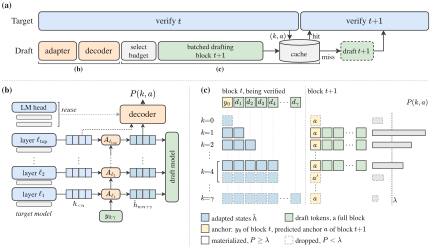
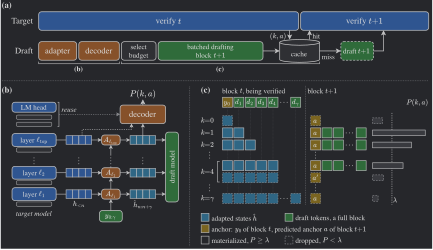

+++
title = "JetSpec++: Foresight Parallel Drafting with Self Refinements"
date = 2026-10-30T12:00:00-07:00
authors = ["Zhaoxiang Feng", "Lanxiang Hu", "Haoran Yuan", "Yu-Yang Qian", "Jihui Yang", "Peng Zhao", "Yibo Zhu", "Tajana Rosing", "Hao Zhang"]
author = "Zhaoxiang Feng, Lanxiang Hu, Haoran Yuan, Yu-Yang Qian, Jihui Yang, Peng Zhao, Yibo Zhu, Tajana Rosing, Hao Zhang"
ShowReadingTime = true
draft = false
[socialIcons]
   [[socialIcons.icon]]
     name = "twitter"
     url = "https://twitter.com"
   [[socialIcons.icon]]
     name = "github"
     url = "https://github.com/hao-ai-lab/JetSpec"
[cover]
     image = "img/foresight-overview.svg"
     alt = "JetSpec++ foresight drafting"
     caption = "Foresight drafting: the adapter, the decoder and the draft model fill the speculation cache."
     hiddenInSingle = true
+++


<style>
  .jspp-table { --j-rule: #ebebeb; --j-strong: #1e1e1e; --j-muted: #6c6c6c; --j-soft: #f5f5f6; --j-hl: rgba(31, 111, 143, 0.10); --j-green: #2f8f5f; }
  body.dark .jspp-table, body.dark .jspp-cap { --j-rule: #333333; --j-strong: #ffffff; --j-muted: #9b9c9d; --j-soft: #26272b; --j-hl: rgba(91, 176, 207, 0.16); --j-green: #5cc090; }
  .post-content .jspp-table { overflow-x: auto; margin: 22px 0 0; }
  .post-content .jspp-table table { display: table; width: 100%; min-width: 760px; margin: 0; border-collapse: collapse; font-size: 14px; }
  .post-content .jspp-table th, .post-content .jspp-table td { padding: 9px 8px; border: 0; border-bottom: 1px solid var(--j-rule); vertical-align: middle; white-space: nowrap; }
  .post-content .jspp-table thead th { border-bottom: 1.5px solid var(--j-strong); color: var(--j-strong); font-weight: 600; }
  .post-content .jspp-table thead tr:first-child th.grp { border-bottom: 1px solid var(--j-rule); text-align: center; }
  .post-content .jspp-table th.sub { color: var(--j-muted); font-weight: 500; text-align: center; }
  .post-content .jspp-table .n { text-align: center; font-family: ui-monospace, "SF Mono", Menlo, Monaco, monospace; font-variant-numeric: tabular-nums; }
  .post-content .jspp-table thead .n { font-family: inherit; }
  .post-content .jspp-table .g { border-left: 1px solid var(--j-rule); }
  .post-content .jspp-table .m { color: var(--j-strong); font-weight: 600; }
  .post-content .jspp-table .setup { color: var(--j-muted); }
  .post-content .jspp-table tr.band td { background: var(--j-soft); color: var(--j-strong); font-weight: 700; }
  .post-content .jspp-table tr.hl td { background: var(--j-hl); font-weight: 600; }
  .post-content .jspp-table tr.hl td.n { color: var(--j-green); }
  .post-content .jspp-table tbody tr:last-child td { border-bottom: 1.5px solid var(--j-strong); }
  .post-content .jspp-cap { --j-muted: #6c6c6c; --j-strong: #1e1e1e; margin: 10px 0 28px; color: var(--j-muted); font-size: 14px; line-height: 1.5; }
  body.dark .post-content .jspp-cap { --j-muted: #9b9c9d; --j-strong: #ffffff; }
  .post-content .jspp-cap b { color: var(--j-strong); font-weight: 600; }
  .post-content div[style*="justify"] + div[style*="justify"] { margin-top: 1em; }
  .jspp-dark { display: none; }
  body.dark .jspp-dark { display: block; }
  body.dark .jspp-light { display: none; }
</style>





**TL;DR**: Speculative decoding speeds up a large model only as far as its drafts are cheap and its acceptance is high. A strong learned draft model that reads the target's hidden states can draft only after each verification, so its cost stays on the critical path. **JetSpec++** keeps the strong draft model and hides almost all of its cost. It drafts the next block on a second GPU while the target verifies the current one. It predicts the verification outcome with **foresight drafting**, and it refines the draft with Jacobi passes while it waits. With the target and the draft model on two GB200 GPUs, it decodes Qwen3-8B up to **7.45× faster than autoregressive decoding** and **1.54× faster than DSpark**.



<figure>
  <div style="display: grid; place-items: center;">
    <video src="img/overview-light.mp4" data-light="img/overview-light.mp4" data-dark="img/overview-dark.mp4" autoplay muted loop playsinline controls preload="metadata" style="width: 100%; height: auto;" aria-label="JetSpec++ overview video"></video>
    <figcaption style="font-size: 16px; color: #808080;">Figure 1: JetSpec++ overview. Parallel drafting today puts the draft on the critical path. JetSpec++ ranks the possible verification outcomes while the target verifies, so the next draft runs under verification. The video ends with a side-by-side decode against DSpark.</figcaption>
  </div>
</figure>


## Background


Two quantities set the speed of speculative decoding: the acceptance length τ, the mean number of tokens that one verification round commits, and the drafting cost. The per-committed-token latency is $L = (T_{\text{draft}} + T_{\text{verify}}) / \tau$. A better draft model raises τ, and a faster one lowers $T_{\text{draft}}$.



Parallel draft models such as [DFlash](https://arxiv.org/abs/2602.06036) predict a whole block in one forward pass. [DSpark](https://arxiv.org/abs/2607.05147) adds sequential heads to such a model. Both read the target's hidden states of the verified context, which gives high acceptance. But those states exist only after verification ends. So drafting is cheap, but it still sits on the critical path of every round.



On Qwen3-8B and GSM8K, one DSpark round takes 9.92 ms. Verification takes 6.16 ms of it. The other 3.76 ms is drafting that the target waits for.



Model-free drafting is cheaper, but its acceptance is low on average. [SSD](https://arxiv.org/abs/2603.03251) overlaps the two stages, but its autoregressive draft model outlasts verification by 8.51 ms per round. JetSpec++ keeps a strong learned draft model and hides almost all of its cost from the critical path.



At a high level, JetSpec++ targets both sides of the speculative-decoding bottleneck:


- **Hidden drafting cost:** draft the next block on a second GPU while the target verifies the current one.
- **High acceptance:** keep the strong draft model, predict the verification outcome with foresight drafting, and refine the draft with Jacobi passes while it waits.
- **Lossless verification:** every committed token passes the target model's rejection sampling rule, so the output distribution of the target model does not change.


## JetSpec++


JetSpec++ combines three parts. Pipelined drafting and verification moves the draft off the critical path. Foresight drafting lets the draft model start before verification ends. Self refinement spends the freed time on better drafts.



### Pipelined drafting and verification


JetSpec++ drafts block t+1 while the target model verifies block t, with the draft model on a second GPU. The draft process predicts the verification outcome: the number of accepted draft tokens and the identity of the bonus token. It fills a speculation cache with one pre-drafted block per likely outcome. A cache hit makes the matching block the next block. A cache miss falls back to an ordinary speculative step.



### Foresight drafting


A draft model that reads the target's hidden states normally waits for verification to finish. Foresight drafting removes this wait. It predicts the target hidden states of the block under verification, scores every possible outcome, and selects the most probable ones. The draft model drafts all selected outcomes in one batch. Without context refresh, the draft model keeps 95 to 98% of the acceptance length it reaches from the target's true states.



The **adapter** is a hidden-to-hidden predictor. At each target layer that the draft model reads, it attends to the cached verified prefix and predicts, in one parallel pass, the target hidden states of every position in the block under verification. The **decoder** turns these predicted states into outcome probabilities. It reuses the frozen weights of the target's last layers, its final norm and its LM head, and it scores every outcome in one causal pass.


<figure>
  <div style="display: grid; place-items: center;">
    
    
    <figcaption style="font-size: 16px; color: #808080;">Figure 2: Foresight drafting. (a) The draft model drafts the selected outcomes in one batch with J+1 passes. (b) At each target layer that the draft model reads, the adapter predicts the states of the current block, and the decoder turns the top-layer predictions into the outcome distribution. (c) The speculation cache for block t+1 holds, for each selected outcome, its accepted draft tokens, the predicted states and the anchor token. Figure from the paper (its Figure 2).</figcaption>
  </div>
</figure>


### Self refinement


A parallel draft model predicts each position in the block without seeing the draft tokens before it. JetSpec++ trains the draft model to repair its own draft instead. Each Jacobi pass lets every position condition on the tokens drafted before it, and the passes run inside the time that pipelining frees.



Between two passes, JetSpec++ simulates verification with the adapter and the decoder. A **context refresh** re-predicts the target hidden states of the current draft. The decoder then finds the first position where its top token differs from the draft, and an **anchor replacement** writes the decoder's token there. The next pass redrafts only the later positions.


<figure>
  <div style="display: grid; place-items: center;">
    <video src="img/mechanism-light.mp4" data-light="img/mechanism-light.mp4" data-dark="img/mechanism-dark.mp4" autoplay muted loop playsinline controls preload="metadata" style="width: 100%; height: auto;" aria-label="Self refinement video"></video>
    <figcaption style="font-size: 16px; color: #808080;">Figure 3: One round of self refinement under verification: a refresh, then a Jacobi pass.</figcaption>
  </div>
</figure>


### Lossless


Every committed token passes the target model's rejection sampling rule, so the output distribution is the target model's own. The draft, the foresight and the refinement change only the proposals.



## Experiments


### Decode speed on GB200


JetSpec++ runs on its own serving engine with CUDA graphs. The target verifies each block on one GPU, and the draft model runs on a second GPU, so the draft of block t+1 overlaps the verification of block t.



With NVFP4 weights and activations, JetSpec++ decodes MATH-500 with Qwen3-8B at **4,117 tok/s** on two GB200 GPUs at batch size 1. In bf16, it decodes **1,361 tok/s**: **7.45× over AR** and **1.51× over DSpark**.


<div class="jspp-table">
<table>
<thead>
<tr><th colspan="2" rowspan="2">Method</th><th class="n" rowspan="2">GPUs</th><th class="grp g" colspan="3">MATH-500</th><th class="grp g" colspan="3">GSM8K</th></tr>
<tr><th class="sub g">tok/s</th><th class="sub">Speedup</th><th class="sub">τ</th><th class="sub g">tok/s</th><th class="sub">Speedup</th><th class="sub">τ</th></tr>
</thead>
<tbody>
<tr class="band"><td colspan="9">Qwen3-8B</td></tr>
<tr><td class="m" colspan="2">AR</td><td class="n">1</td><td class="n g">182.7</td><td class="n">1.00×</td><td class="n">1.00</td><td class="n g">182.3</td><td class="n">1.00×</td><td class="n">1.00</td></tr>
<tr><td class="m" rowspan="2">DSpark</td><td class="setup">Colocated</td><td class="n">1</td><td class="n g">902.1</td><td class="n">4.94×</td><td class="n">8.98</td><td class="n g">744.3</td><td class="n">4.08×</td><td class="n">7.34</td></tr>
<tr><td class="setup">Disaggregated</td><td class="n">2</td><td class="n g">929.3</td><td class="n">4.94×</td><td class="n">9.03</td><td class="n g">774.0</td><td class="n">4.13×</td><td class="n">7.42</td></tr>
<tr><td class="m" rowspan="2">DFlash</td><td class="setup">Colocated</td><td class="n">1</td><td class="n g">795.5</td><td class="n">4.35×</td><td class="n">7.65</td><td class="n g">620.1</td><td class="n">3.40×</td><td class="n">5.87</td></tr>
<tr><td class="setup">Disaggregated</td><td class="n">2</td><td class="n g">808.4</td><td class="n">4.30×</td><td class="n">7.72</td><td class="n g">625.6</td><td class="n">3.34×</td><td class="n">5.87</td></tr>
<tr><td class="m" colspan="2">SSD</td><td class="n">2</td><td class="n g">282.5</td><td class="n">1.55×</td><td class="n">4.20</td><td class="n g">276.5</td><td class="n">1.52×</td><td class="n">4.06</td></tr>
<tr class="hl"><td class="m" colspan="2">JetSpec++ J1-R1</td><td class="n">2</td><td class="n g">1,361.1</td><td class="n">7.45×</td><td class="n">9.41</td><td class="n g">1,148.8</td><td class="n">6.30×</td><td class="n">7.78</td></tr>
<tr class="band"><td colspan="9">Qwen3.8-27B</td></tr>
<tr><td class="m" colspan="2">AR</td><td class="n">1</td><td class="n g">59.3</td><td class="n">1.00×</td><td class="n">1.00</td><td class="n g">60.3</td><td class="n">1.00×</td><td class="n">1.00</td></tr>
<tr><td class="m" rowspan="2">DSpark</td><td class="setup">Colocated</td><td class="n">1</td><td class="n g">279.8</td><td class="n">4.72×</td><td class="n">8.99</td><td class="n g">249.6</td><td class="n">4.14×</td><td class="n">7.93</td></tr>
<tr><td class="setup">Disaggregated</td><td class="n">2</td><td class="n g">299.8</td><td class="n">4.96×</td><td class="n">9.02</td><td class="n g">264.1</td><td class="n">4.43×</td><td class="n">7.89</td></tr>
<tr class="hl"><td class="m" colspan="2">JetSpec++ J3-R3</td><td class="n">2</td><td class="n g">367.2</td><td class="n">6.20×</td><td class="n">10.45</td><td class="n g">342.4</td><td class="n">5.68×</td><td class="n">9.67</td></tr>
</tbody>
</table>
</div>

<p class="jspp-cap"><b>Table 1: Decode speed at batch size 1 on GB200.</b> Temperature 0, 128 prompts per benchmark.</p>


### Acceptance length


JetSpec++ commits more tokens per verification round than every baseline on all seven benchmarks, at temperatures 0 and 1 and at verification budgets 16 and 32. At temperature 0 and budget 16, J3-R3 averages 8.94 tokens per round on Qwen3-8B, against 6.89 for DSpark.


<div class="jspp-table">
<table>
<thead>
<tr><th>Method</th><th class="n">Budget</th><th class="n g">GSM8K</th><th class="n">MATH-500</th><th class="n">AIME25</th><th class="n">HumanEval</th><th class="n">MBPP</th><th class="n">LCB</th><th class="n">MT-Bench</th></tr>
</thead>
<tbody>
<tr class="band"><td colspan="9">Qwen3-8B</td></tr>
<tr><td class="m" rowspan="2">DFlash</td><td class="n">16</td><td class="n g">5.91</td><td class="n">7.59</td><td class="n">6.89</td><td class="n">5.16</td><td class="n">4.91</td><td class="n">5.45</td><td class="n">3.24</td></tr>
<tr><td class="n">32</td><td class="n g">5.18</td><td class="n">6.67</td><td class="n">6.07</td><td class="n">4.53</td><td class="n">4.31</td><td class="n">4.70</td><td class="n">2.95</td></tr>
<tr><td class="m" rowspan="2">DSpark</td><td class="n">16</td><td class="n g">7.31</td><td class="n">9.01</td><td class="n">8.35</td><td class="n">6.57</td><td class="n">6.17</td><td class="n">6.92</td><td class="n">3.89</td></tr>
<tr><td class="n">32</td><td class="n g">7.06</td><td class="n">8.66</td><td class="n">7.73</td><td class="n">6.25</td><td class="n">5.85</td><td class="n">6.38</td><td class="n">3.77</td></tr>
<tr><td class="m" rowspan="2"><a href="https://arxiv.org/abs/2605.29707">Domino</a></td><td class="n">16</td><td class="n g">6.91</td><td class="n">8.74</td><td class="n">8.09</td><td class="n">6.06</td><td class="n">5.90</td><td class="n">6.27</td><td class="n">3.74</td></tr>
<tr><td class="n">32</td><td class="n g">6.25</td><td class="n">7.96</td><td class="n">7.37</td><td class="n">5.61</td><td class="n">5.29</td><td class="n">5.92</td><td class="n">3.49</td></tr>
<tr><td class="m" rowspan="2"><a href="/blogs/parallel-tree-decoding/">JetSpec</a></td><td class="n">16</td><td class="n g">5.90</td><td class="n">7.43</td><td class="n">6.78</td><td class="n">5.28</td><td class="n">4.92</td><td class="n">5.45</td><td class="n">3.17</td></tr>
<tr><td class="n">32</td><td class="n g">6.02</td><td class="n">7.81</td><td class="n">7.02</td><td class="n">5.34</td><td class="n">4.96</td><td class="n">5.53</td><td class="n">3.19</td></tr>
<tr class="hl"><td class="m" rowspan="2">JetSpec++ J1-R1</td><td class="n">16</td><td class="n g">7.98</td><td class="n">9.63</td><td class="n">8.97</td><td class="n">7.23</td><td class="n">6.73</td><td class="n">7.59</td><td class="n">4.38</td></tr>
<tr class="hl"><td class="n">32</td><td class="n g">8.77</td><td class="n">11.45</td><td class="n">10.42</td><td class="n">7.70</td><td class="n">7.02</td><td class="n">8.29</td><td class="n">4.52</td></tr>
<tr class="hl"><td class="m" rowspan="2">JetSpec++ J3-R3</td><td class="n">16</td><td class="n g">9.78</td><td class="n">11.04</td><td class="n">10.49</td><td class="n">8.79</td><td class="n">8.24</td><td class="n">8.95</td><td class="n">5.29</td></tr>
<tr class="hl"><td class="n">32</td><td class="n g">11.83</td><td class="n">14.55</td><td class="n">13.13</td><td class="n">10.27</td><td class="n">9.25</td><td class="n">10.50</td><td class="n">5.51</td></tr>
<tr class="band"><td colspan="9">Qwen3.8-27B</td></tr>
<tr><td class="m" rowspan="2">DSpark</td><td class="n">16</td><td class="n g">8.02</td><td class="n">8.94</td><td class="n">8.30</td><td class="n">8.19</td><td class="n">7.62</td><td class="n">5.19</td><td class="n">4.00</td></tr>
<tr><td class="n">32</td><td class="n g">7.57</td><td class="n">8.49</td><td class="n">7.64</td><td class="n">7.13</td><td class="n">6.96</td><td class="n">4.84</td><td class="n">3.83</td></tr>
<tr class="hl"><td class="m" rowspan="2">JetSpec++ J1-R1</td><td class="n">16</td><td class="n g">8.71</td><td class="n">9.53</td><td class="n">8.58</td><td class="n">9.18</td><td class="n">8.41</td><td class="n">5.80</td><td class="n">4.30</td></tr>
<tr class="hl"><td class="n">32</td><td class="n g">9.68</td><td class="n">11.10</td><td class="n">9.82</td><td class="n">10.72</td><td class="n">9.42</td><td class="n">5.94</td><td class="n">4.40</td></tr>
<tr class="hl"><td class="m" rowspan="2">JetSpec++ J3-R3</td><td class="n">16</td><td class="n g">10.05</td><td class="n">10.83</td><td class="n">10.15</td><td class="n">10.72</td><td class="n">9.80</td><td class="n">6.93</td><td class="n">4.91</td></tr>
<tr class="hl"><td class="n">32</td><td class="n g">12.35</td><td class="n">14.05</td><td class="n">12.49</td><td class="n">13.47</td><td class="n">11.76</td><td class="n">7.43</td><td class="n">5.15</td></tr>
</tbody>
</table>
</div>

<p class="jspp-cap"><b>Table 2: Tokens per round (τ) at temperature 0 and budgets 16 and 32.</b> J1-R1 runs one Jacobi pass with one context refresh and anchor replacement, and J3-R3 runs three of each.</p>


### Throughput and per-user speed


Larger batches raise total throughput but slow down each request. In preliminary runs on Qwen3-8B and MATH-500, JetSpec++ leads DSpark on both throughput and per-user speed at batch sizes 2 to 4.


<div class="jspp-table">
<table>
<thead>
<tr><th colspan="2" rowspan="2">Method</th><th class="grp g" colspan="2">Batch size 1</th><th class="grp g" colspan="2">Batch size 2</th><th class="grp g" colspan="2">Batch size 3</th><th class="grp g" colspan="2">Batch size 4</th></tr>
<tr><th class="sub g">Total</th><th class="sub">Per user</th><th class="sub g">Total</th><th class="sub">Per user</th><th class="sub g">Total</th><th class="sub">Per user</th><th class="sub g">Total</th><th class="sub">Per user</th></tr>
</thead>
<tbody>
<tr><td class="m" colspan="2">AR</td><td class="n g">182.7</td><td class="n">182.7</td><td class="n g">369.9</td><td class="n">185.0</td><td class="n g">548.2</td><td class="n">182.7</td><td class="n g">702.8</td><td class="n">175.7</td></tr>
<tr><td class="m" rowspan="2">DSpark</td><td class="setup">One GPU</td><td class="n g">902.1</td><td class="n">902.1</td><td class="n g">1,756.4</td><td class="n">878.2</td><td class="n g">2,335.2</td><td class="n">778.4</td><td class="n g">3,034.0</td><td class="n">758.5</td></tr>
<tr><td class="setup">Two GPUs</td><td class="n g">–</td><td class="n">–</td><td class="n g">1,877.2</td><td class="n">938.6</td><td class="n g">2,680.6</td><td class="n">893.5</td><td class="n g">3,482.3</td><td class="n">870.6</td></tr>
<tr class="hl"><td class="m" colspan="2">JetSpec++</td><td class="n g">1,361.1</td><td class="n">1,361.1</td><td class="n g">2,249.4</td><td class="n">1,124.7</td><td class="n g">3,078.4</td><td class="n">1,026.1</td><td class="n g">3,859.1</td><td class="n">964.8</td></tr>
</tbody>
</table>
</div>

<p class="jspp-cap"><b>Table 3: Total and per-user tok/s on GB200, Qwen3-8B, MATH-500.</b> Batch size 1 is from the paper. Batch sizes 2 to 4 are preliminary, from an unreleased development branch with batch optimizations on JetSpec++ only. JetSpec++ runs J1-R1 on two GPUs, with a reduced draft vocabulary above batch size 1. AR runs on one GPU. For DSpark, two GPUs means data parallelism (DP): one replica on each GPU.</p>


## Coming soon


**Larger targets.** As target size grows, verification becomes more expensive relative to drafting, which creates a larger window for refinement. We plan to train JetSpec++ for production models that span many GPUs, where the draft model would add only a small share of the hardware.



**Higher batch sizes.** We are extending JetSpec++ to higher batch sizes and realistic serving workloads. The goal is for drafting to fit around the batched verification schedule, so that the GPUs serving the target model stay fully utilized.



## Get Started


For more details, please see the JetSpec++ paper and codebase:


- Paper: https://arxiv.org/abs/2610.19792
- Website: https://jetspec-project.github.io/jetspecpp-web/
- GitHub: https://github.com/hao-ai-lab/JetSpec
- Model Zoo: https://huggingface.co/collections/JetSpec/jetspec-plus-plus-releases


Because every committed token passes the target model's rejection sampling rule, JetSpec++ can serve an existing target model with a [draft model](https://huggingface.co/collections/JetSpec/jetspec-plus-plus-releases) on a second GPU while it preserves the target output distribution.



## Citation

```bibtex
@misc{feng2026jetspecpp,
 title  = {JetSpec++: Foresight Parallel Drafting with Self Refinements},
 author = {Feng, Zhaoxiang and Hu, Lanxiang and Yuan, Haoran and Qian, Yu-Yang and Yang, Jihui and
           Zhao, Peng and Zhu, Yibo and Rosing, Tajana and Zhang, Hao},
 year   = {2026},
 eprint = {2610.19792},
 archivePrefix = {arXiv},
 primaryClass = {cs.CL},
 url    = {https://arxiv.org/abs/2610.19792}
}
```

<script>
  // Follow the blog's theme toggle, and keep the playback position when the theme changes.
  (function () {
    function sync() {
      var dark = document.body.classList.contains('dark');
      document.querySelectorAll('video[data-dark]').forEach(function (v) {
        var src = dark ? v.dataset.dark : v.dataset.light;
        if (v.getAttribute('src') === src) return;
        var t = v.currentTime, playing = !v.paused;
        v.setAttribute('src', src);
        v.addEventListener('loadedmetadata', function () { v.currentTime = t; if (playing) v.play(); }, { once: true });
      });
    }
    sync();
    new MutationObserver(sync).observe(document.body, { attributes: true, attributeFilter: ['class'] });
  })();
</script>
